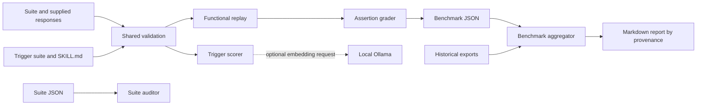

# Architecture

## Context

Evals is a local Python toolkit. Operators provide JSON suites, saved responses,
and skill metadata. The tools return grading evidence, trigger scores, audit
findings, or Markdown benchmark summaries. There is no web server, database,
background worker, deployment service, or repository-owned MCP server.

## Components and data flow

1. `runner/validation.py` checks suite shapes and field types before scoring.
2. `runner/eval_runner.py` selects caller-supplied responses in replay mode, or
   expected answers in explicit dry-run mode. It sends only that response text to
   `runner/grader.py` and records the mode in its summary.
3. `runner/trigger_runner.py` parses YAML frontmatter, extracts trigger and skip
   clauses, and scores labelled queries. Optional embeddings supplement plain
   token overlap. Results identify which scoring mode actually ran.
4. `benchmarks/suite_validator.py` checks schema and a documented subset of suite
   quality checks. It reads fixture metadata but does not execute the fixtures.
5. `benchmarks/aggregate.py` validates counters, derives rates, deduplicates
   identical records, and separates replay, dry-run, and legacy provenance.

The [component reference](COMPONENTS.md) lists public interfaces. The
[external-call inventory](external-calls.md) describes the optional network call.

## Runtime and storage

Each CLI runs as one foreground process. Suites, skill files, output maps, and
benchmark files are ordinary local files. Output paths are operator-selected;
functional result names use validated safe skill slugs. There is no persistent
application cache. The optional Ollama endpoint defaults to
`http://localhost:11434` in `runner/config.py`.

## Decisions

- **ADR 1: separate expected answers from observations.** Replay grades supplied
  responses. Expectation-only dry runs have distinct provenance. Unsupported live
  execution fails instead of manufacturing a result.
- **ADR 2: keep model comparisons consistent.** Embedding comparisons use the same
  pinned `qwen3-embedding:4b` model. Lexical fallback is visible in result metadata.
- **ADR 3: preserve historical evidence.** Legacy exports stay unchanged and are
  reported separately. Missing provenance cannot be reconstructed from a pass
  percentage.
- **ADR 4: use local path indexes.** Repository retrieval indexes describe paths
  and symbols. Bootstrap does not build embeddings or start file watchers.

## Quality constraints

Malformed input and unsupported checks must not become passing results. Tests
must use synthetic responses and fake embedding endpoints. No numeric latency or
coverage target is enforced. CI checks Python 3.11 and 3.14; see [testing](TESTING.md).
